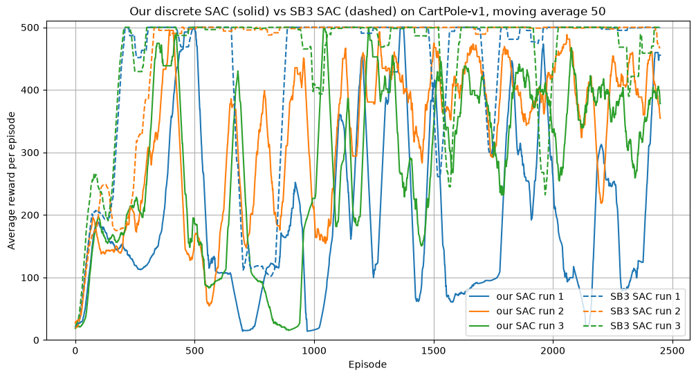
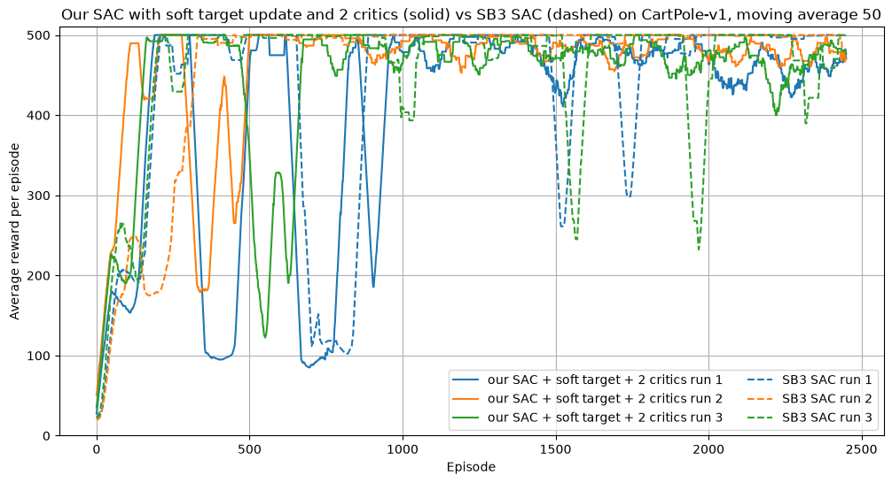
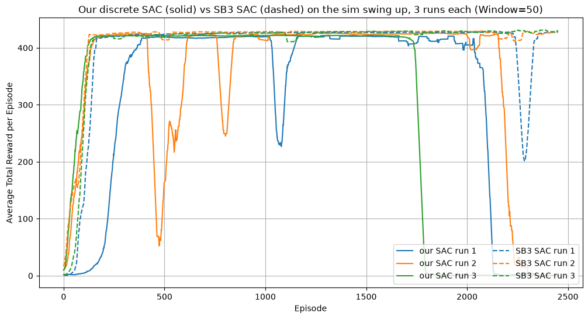

# Experiments

| Experiment | Date | Commit |
|---|---|---|
| [experiment001](#experiment001) | 2026-11-23 | [`b214432`](https://github.com/abhismirai42/reinforcement_learning/commit/b214432fc912ab377c2dd5ef3b18633a6a940876) |
| [experiment002](#experiment002) | 2026-11-24 | [`7f46374`](https://github.com/abhismirai42/reinforcement_learning/commit/7f46374aa421d85fc223bd18f310a3e1eea90ac3) |
| [experiment003](#experiment003) | 2026-11-27 | [`08348a4`](https://github.com/abhismirai42/reinforcement_learning/commit/08348a4b2f875ded371d664b80feff1d001a22eb) |
| [experiment004](#experiment004) | 2026-11-27 | [`4c32b7c`](https://github.com/abhismirai42/reinforcement_learning/commit/4c32b7c0f2a9563ac10232e3a139971118d2b004) |

---

## experiment001

**Question:** How good is our discrete SAC implementation compared to an SB3 SAC on the same env?

**Setup**
- Env: gym CartPole-v1.
- Ours: `02_cart_pole/06_Soft_Actor_Critic.ipynb`: 1 critic, hard target copy every 500 steps, alpha 0.2 fixed, lr 1e-3, batch 64, nets 64 x 64, replay 100 000.
- SB3: `02_cart_pole/06_Soft_Actor_Critic_sb3.ipynb`: stable-baselines3 2.9.2 SAC defaults: 2 critics, soft target tau 0.005, automatic alpha, lr 3e-4, batch 256, nets 256 x 256, replay 1 000 000. Its continuous action a maps to left (a < 0) or right (a >= 0), so the physics are the same.
- Both: 1 gradient step per env step, 2500 episodes x 3 runs, checkpoint every 500 episodes.

**Procedure:** Ran each notebook's 3 runs from scratch. Ours ~15 to 20 min per run, SB3 ~2 h per run. Plotted the 50 episode moving average of every run.

**Observations**
- **O1** All 6 runs reach a 50 episode average of 400.
- **O2** SB3 reaches 400 around episode 250 (2 of 3 runs); ours around episode 400 to 500.
- **O3** After learning, SB3 stays near 500 with short dips (lowest ~230). Ours keeps crashing and recovering, run 1 down to ~20, several times.
- **O4** Episode 1250 to 2500 mean: ours 216, 397, 356; SB3 480, 498, 470.

**Questions & next**
- Same algorithm family and env, so is the crashing (O3) caused by one of the differences in Setup? They all change at once here (e.g. 1 vs 2 critics, hard vs soft target update, fixed vs automatic alpha, lr 1e-3 vs 3e-4), so this experiment cannot tell which.
- Next: add them to ours one at a time

---

## experiment002

**Question:** Does a soft target update (instead of the hard copy every 500 steps) stop our SAC from crashing (001.O3)?

**Setup**
- Same as experiment001, one change: target update `target = tau * critic + (1 - tau) * target` after every gradient step, tau 0.005. Before: hard copy every 500 steps.

**Procedure:** Ran the 3 runs from scratch, ~20 min per run. Plotted the 50 episode moving average of every run next to SB3 from experiment001.

**Observations**
- **O1** Episode 1250 to 2500 mean: 452, 454, 442 (experiment001 ours: 216, 397, 356; SB3: 480, 498, 470).
- **O2** Until episode ~1100 it still crashes, down to ~25 to 100, like experiment001.
- **O3** After episode ~1300 it stays between ~400 and ~490 in all 3 runs, one short dip to ~170 in run 3.
- **O4** It levels off around 450, SB3 around 480 to 500.

**Questions & next**
- The crashing stops in the second half (O1, O3), not in the first ~1100 episodes (O2).
- Why does it still crash early on and then settle?
- Next: 2 critics, on top of the soft target update.

---

## experiment003

**Question:** Do 2 critics (min of both) on top of the soft target update remove the early crashes (002.O2) and raise the level (002.O4)?

**Setup**
- Same as experiment002, one change: 2 critics and 2 target critics. The TD target uses the min of the 2 target critics, the actor loss uses the min of the 2 critics, each critic has its own MSE loss (summed, one optimizer), both targets get the soft update.

**Procedure:** Ran the 3 runs from scratch, ~30 min per run. Plotted the 50 episode moving average of every run next to SB3 from experiment001.

**Observations**
- **O1** Episode 1250 to 2500 mean: 470, 483, 473 (experiment002: 452, 454, 442; SB3: 480, 498, 470).
- **O2** It still crashes early on, but less deep and it stops earlier: lowest ~85, ~180, ~120 before episode ~1000 (experiment002: down to ~25 to 100 until episode ~1100).
- **O3** After episode ~1000 it stays above ~400 in all 3 runs. SB3 in the same part has dips to ~230 to ~300.
- **O4** It levels off around 470 to 485, SB3 around 480 to 500.

**Questions & next**
- With the soft target update and 2 critics ours is now about as good as SB3 (O1, O4) and more steady in the second half (O3).
- The early crashes (O2) are still there, SB3 has a few too. Is it the fixed alpha, or the lr 1e-3?
- Next: lets move to real env? or create real like sim env and checked on it?

---

## experiment004

**Question:** Does the experiment003 SAC also learn and keep the swing up on a sim like the real cart, compared to SB3 SAC?

**Setup**
- Same as experiment003, but on `02_cart_pole/sim_cart_pole_env.py`: gym physics with the real env's 3 actions, reward and hanging start, ends at the track edge or spin > 20 rad/s, 500 steps max. Like on the real cart it trains after each whole episode, replay 1 000 000 (`02_cart_pole/06_Soft_Actor_Critic_env2.ipynb`).
- SB3 SAC on the same sim.

**Procedure:** 3 runs each from scratch, ours ~40 min per run, SB3 ~140 min per run. Plotted the 50 episode moving average of every run.

**Observations**
- **O1** Both learn the swing up, a 50 episode average of ~420 by episode ~170 to 410 (about 430 is the most per episode here).
- **O2** SB3 keeps it until the end in all 3 runs.
- **O3** Ours collapses to ~0 near the end (episode ~1780 to 2250) and does not come back, the final policies drive the cart off the track.

**Questions & next**
- Ours learns the swing up but does not keep it, SB3 does. Is it the fixed alpha, or training after the whole episode?
- Next: automatic alpha.
